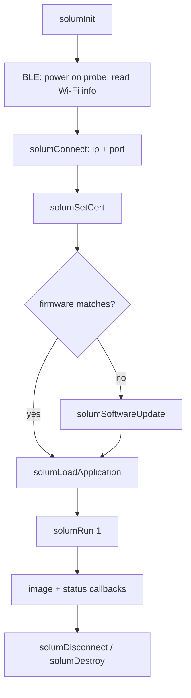

# Getting Started with Solum

This guide walks through writing a Solum application from first connection to live
imaging and raw data capture. It targets the publicly released **v12** SDK. Code
snippets are C/C++ using the headers in [`include/solum`](../include/solum); the same
call sequence applies to the Python (`pysolum`), Swift, and Android bindings shipped in
[`examples`](../examples).

> Solum is an OEM SDK: it provides connectivity and imaging control only. There is no
> Clarius Cloud, DICOM, measurement, or reporting functionality — those live in the
> Clarius App. See the [README](../README.md) for prerequisites (commercial partner, an
> `oem` license per probe).

## The big picture

A Solum app drives the probe over two transports:

- **Bluetooth Low Energy (BLE)** — power the probe on/off and discover the Wi-Fi
  network (IP address + port). **You implement this yourself** with the BLE library of
  your platform; Solum does not include a BLE stack. See
  [specifications.md](../specifications.md) for the GATT services and characteristics.
- **Wi-Fi / TCP + UDP** — everything Solum does: control over TCP, image streaming over
  UDP. This is what the SDK handles.

The typical lifecycle is:



## 1. Obtain a probe certificate

A probe will not load applications, update firmware, or image until it has been
authenticated with a certificate issued by Clarius. Certificates are retrieved from
Clarius Cloud using an **OEM API key**.

1. In Clarius Cloud (admin account): **Institution Settings → Policies → OEM API Keys →
   Add New Key**. Store it securely — it is shown only once.
2. Pull the certificates for every `oem`-licensed probe in your institution:

```bash
curl -H "Authorization: OEM-API-Key <your key>" \
  "https://cloud.clarius.com/api/public/v0/devices/oem/"
```

Each device entry contains a `crt` field (the certificate string) keyed by serial
number. See [`auth-request.py`](../auth-request.py) for a complete Python example that
walks the response. Cache the certificate locally and pass it to `solumSetCert()` after
connecting.

## 2. Initialize the SDK

Fill in a `CusInitParams` (start from `solumDefaultInitParams()` so new fields stay
zero-initialized), register your callbacks, set the output buffer size, and call
`solumInit()`. **`solumInit` must succeed before any other call.**

```c
#include <solum/solum.h>

CusInitParams params = solumDefaultInitParams();
params.args.argc = argc;
params.args.argv = argv;            // forwarded to Qt for graphics buffer init
params.storeDir  = "/path/to/keys"; // writable dir for security keys
params.width     = 640;             // output image width  (pixels)
params.height    = 480;             // output image height (pixels)

// register the callbacks you care about
params.connectFn           = connectFn;
params.certFn              = certFn;
params.imagingFn           = imagingFn;
params.newProcessedImageFn = newProcessedImageFn; // scan-converted frames
params.newRawImageFn       = newRawImageFn;        // pre-scan / RF frames
params.errorFn             = errorFn;
params.powerDownFn         = powerDownFn;
params.buttonFn            = buttonFn;

if (solumInit(&params) < 0)
    return -1; // initialization failed
```

All callbacks are documented in the [API reference](api-reference.md#callbacks). Every
SDK function returns `0` (`CUS_SUCCESS`) on success and `-1` (`CUS_FAILURE`) on failure
unless noted otherwise.

## 3. Power on the probe and find it (BLE)

Using your own BLE code, connect to the probe and:

1. Write `0x01` to the **Power Request** characteristic to power it on.
2. Subscribe to the **Wi-Fi Published** characteristic and wait for a `state: connected`
   payload. It contains the `ip4` address and control port (`ctl`) you need to connect.

The exact UUIDs, payload format (YAML), and how to put the probe on its own access point
vs. an external router are in [specifications.md](../specifications.md#connectivity).

## 4. Connect over TCP

```c
CusConnectionParams cp = solumDefaultConnectionParams();
cp.ipAddress = "192.168.1.1";  // from the Wi-Fi Published characteristic
cp.port      = 12345;          // the control port (ctl)

if (solumConnect(&cp) < 0)
    return -1;
```

Connection results arrive on your `connectFn` as a `CusConnection` value: `ProbeConnected`
on success, or `ConnectionFailed`, `SwUpdateRequired`, `OSUpdateRequired`, etc. Don't
proceed until you see `ProbeConnected`.

## 5. Set the certificate

Send the certificate string you fetched in step 1:

```c
solumSetCert(certString);
```

Your `certFn` reports how many days the certificate remains valid. A value of
`CERT_INVALID` (`-1`) means the certificate is invalid or missing; `0` means expired.
Imaging is blocked until a valid certificate is set.

## 6. Match firmware

The SDK and the probe firmware must match for imaging to work. Ask the SDK which firmware
version it expects, then download that build from Clarius Cloud and push it to the probe:

```c
char version[128];
solumFwVersion(HD3, version, sizeof(version)); // platform of your probe
```

```bash
curl -H "Authorization: OEM-API-Key <your key>" \
  "https://cloud.clarius.com/api/public/v0/devices/oem/firmware/<version>/"
```

```c
solumSoftwareUpdate("/path/to/firmware", swUpdateFn, progressFn, 0);
```

`swUpdateFn` reports a `CusSwUpdate` result (`SwUpdateSuccess`, `SwUpdateCurrent`, …) and
`progressFn` reports percent complete. The firmware binary is **not** embedded in the
library — it must always be downloaded from the Cloud. Pass `0` for the last argument
(`hwVer`) unless Clarius tells you to force a hardware version.

## 7. Load an application

List the probe models the SDK supports and the workflows (applications) available for a
model, then load one. Lists arrive as comma-separated strings on a `CusListFn` callback.

```c
solumProbes([](const char* list, int sz) { /* e.g. "C3HD3,L15HD3,..." */ });
solumApplications("C3HD3", [](const char* list, int sz) { /* "abdomen,lung,..." */ });

solumLoadApplication("C3HD3", "abdomen");
```

When the application finishes loading, your `imagingFn` fires with `ImagingReady`. (In
v12 `solumLoadApplication` takes the probe and workflow only; v13 adds an `array`
argument for multi-array probes.)

## 8. Start imaging

```c
solumSetOutputSize(640, 480); // optional; can also be set in init
solumRun(1);                  // 1 = start, 0 = stop
```

Processed frames now arrive on `newProcessedImageFn`, raw/pre-scan frames on
`newRawImageFn`. `solumIsImaging()` returns the current run state.

### Handling images

```c
void newProcessedImageFn(const void* img, const CusProcessedImageInfo* nfo,
                         int npos, const CusPosInfo* pos)
{
    // img is nfo->imageSize bytes; default format is 32-bit ARGB.
    // nfo->width x nfo->height, nfo->micronsPerPixel for scaling.
    // pos[0..npos) holds IMU samples tagged to this frame (if IMU streaming is on).
}
```

- Default output is uncompressed 32-bit ARGB. Use `solumSetFormat()` to switch to 8-bit
  grayscale, JPEG, or PNG (see [`CusImageFormat`](api-reference.md#enumerations)).
- For overlays (color Doppler, strain), call `solumSeparateOverlays(1)` to receive the
  grayscale frame and the colorized overlay as separate callbacks.
- Pre-scan-converted and RF data come through `newRawImageFn`; check `nfo->rf` to tell
  RF from envelope data. Raw image data is in polar (ultrasound) coordinates.

## 9. Adjust parameters and modes

```c
solumSetParam(ImageDepth, 7.0);   // cm
solumSetParam(Gain, 60.0);        // percent
solumSetMode(ColorMode);          // switch to color Doppler

double depth = solumGetParam(ImageDepth);
CusRange r;  solumGetRange(ImageDepth, &r); // valid min/max for current state
```

The full list of imaging parameters (units, ranges, defaults), imaging modes, TGC, ROI,
and gate control is in the [parameter reference](parameters.md). For lower-level acoustic
control there is a separate set of [low-level parameters](parameters.md#low-level-parameters).

## 10. Capture raw data

Raw data (IQ, RF, envelope) can be pulled off the probe once imaging is **frozen** and
buffering was enabled while imaging:

```c
solumSetParam(RawBuffer, 1);   // enable buffering before/while imaging
// ... image, then freeze ...
solumRun(0);                   // stop/freeze

solumRawDataAvailability(availFn);                 // 1. what timestamps are buffered
solumRequestRawData(0, 0, 1, reqFn);               // 2. request all (lzo=1 compresses)
// reqFn returns the byte size to allocate; then:
solumReadRawData(&buffer, rawFn, progressFn);      // 3. download into your buffer
```

`solumRequestRawData(start, end, lzo, fn)` selects frames by nanosecond timestamp
(`0,0` = everything buffered); `lzo=1` returns an LZO-compressed tarball. The on-disk
format of the resulting package is documented in the
[research repository](https://github.com/clariusdev/research).

## 11. Disconnect and clean up

```c
solumRun(0);
solumDisconnect();   // drop the TCP connection
solumPowerDown();    // optionally power the probe off over TCP
solumDestroy();      // free SDK resources before exiting
```

`solumPowerDown()` is handy when you want to shut the probe down without re-attaching
over BLE. Always call `solumDestroy()` before your process exits.

## A complete minimal flow

The console example in [`examples/solum_console/main.cpp`](../examples/solum_console/main.cpp)
implements this entire sequence interactively. Its built-in help summarizes the typical
order:

```
power up and fetch tcp information via ble (not demonstrated)
connect over wifi/tcp        -> solumConnect
load certificate             -> solumSetCert
check for software update    -> solumFwVersion / solumSoftwareUpdate
load workflow                -> solumProbes / solumApplications / solumLoadApplication
image, get status, adjust    -> solumRun / solumStatusInfo / solumSetParam / solumSetMode
```

## Where to go next

- [API reference](api-reference.md) — every function, callback, enum, and struct
- [Parameter reference](parameters.md) — imaging parameters, modes, TGC, ROI, low-level controls
- [specifications.md](../specifications.md) — BLE services, supported probes, applications, modes
- [design.md](../design.md) — architecture notes
